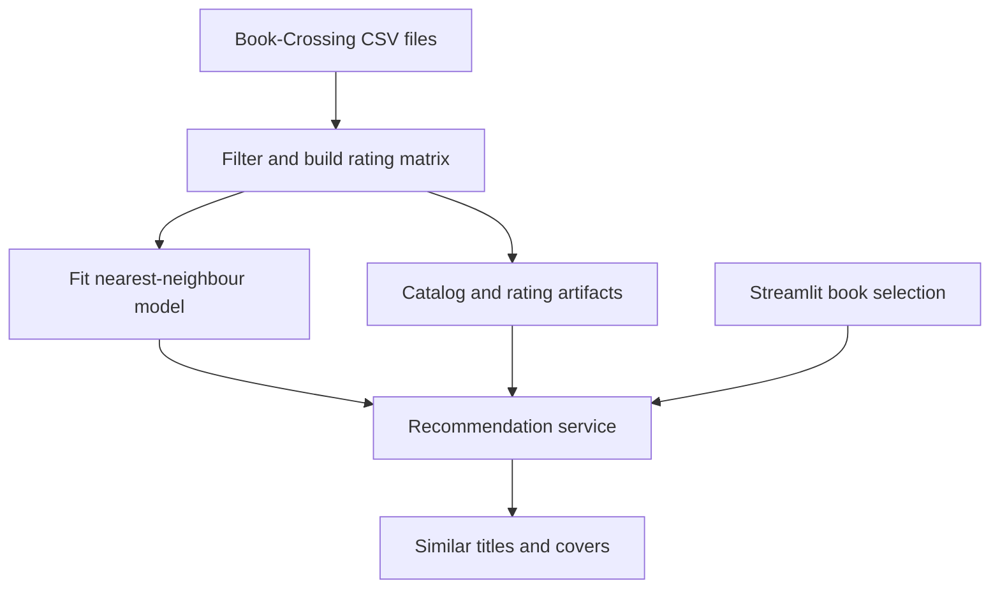

[](https://github.com/Preritsangwan17/End-to-End-Book-Recommendation-System/actions/workflows/ci.yml)

# Book Recommendation System

An item-based collaborative-filtering project with a staged training pipeline and a Streamlit interface.
The system finds books with similar reader-rating patterns using a sparse book-by-user matrix and
brute-force nearest-neighbour search.

## Project highlights

- Four stages: local data ingestion, filtering/validation, matrix transformation and model fitting.
- Book-Crossing CSV parsing supports the dataset's semicolon separator and Latin-1 encoding.
- Active-reader and frequently-rated-book filters reduce sparse noise.
- A cached inference service handles missing artifacts with an actionable setup message.
- Recommendations explicitly exclude the selected book, including ties in neighbour distance.
- The interface adapts to smaller catalogs and returns cover URLs when available.

## Quick start

Python 3.11 or 3.12:

```bash
git clone https://github.com/Preritsangwan17/End-to-End-Book-Recommendation-System.git
cd End-to-End-Book-Recommendation-System
python3 -m venv .venv
source .venv/bin/activate
python -m pip install -r requirements.txt
python main.py
python -m streamlit run app.py
```

Open the local URL printed by Streamlit. Training uses the included `notebook/BX-*.csv` files first,
then the local ZIP, then the configured download URL. No network is needed with the committed CSVs.
Training produces current artifacts in `artifacts/`; historical notebook artifacts are not loaded by the app.

## Architecture



Users with more than 200 rating records are retained. Books require at least 50 records in that filtered
population. Duplicate user/title pairs are removed and missing matrix values are filled with zero.
The current model uses Euclidean distance, the default for `NearestNeighbors(algorithm="brute")`;
this repository does **not** claim cosine similarity or personalized user recommendations.

## Repository guide

| Path | Purpose |
|---|---|
| `book_recommender_system/components/` | Four training stages |
| `book_recommender_system/config/` | Configuration objects |
| `book_recommender_system/recommendation.py` | Artifact loading and recommendation logic |
| `config/config.yaml` | Data and artifact locations |
| `main.py` | Training entry point |
| `app.py` | Streamlit interface |
| `notebook/research.ipynb` | Historical exploration |
| `tests/` | Missing-artifact, unknown-title and tied-distance regression checks |

## Data and model limits

The source files are a Book-Crossing dataset copy retained from the original project. Verify the original
source and redistribution terms before publishing the data elsewhere; this repository did not include
an independent dataset-license record. The existing MIT license covers project code, not third-party data.

Zero ratings in Book-Crossing can indicate implicit feedback; filling missing entries with zero conflates
that signal with absent ratings. Euclidean distance can favor rating magnitude/activity over preference.
The dense pivot is converted to sparse storage for model fitting, but constructing the pivot still uses memory.
New users and unseen titles have no cold-start strategy. No held-out ranking evaluation has been completed;
add Recall@K/NDCG@K and a popularity baseline before claiming recommendation quality.

## Verification and containers

```bash
python -m pip install -r requirements-dev.txt
python -m pytest -q
```

The training pipeline was run against the committed CSVs during cleanup. Tests verify recommendation
behavior on a small synthetic catalog. Software tests do not establish ranking performance.
Only load pickle artifacts you trust.

Optional container, after local training:

```bash
docker build -t book-recommender .
docker run --rm -p 8501:8501 book-recommender
```

The container includes the current artifacts if trained before the build; it excludes the raw notebook
dataset. Docker commands are provided for convenience and were not executed in this environment.

## License and author

[MIT](LICENSE) · [Contribution guidance](CONTRIBUTING.md)

Built by [Prerit Sangwan](https://github.com/Preritsangwan17), B.Tech CSE (AI/ML).

## Model documentation

See the [model card](docs/MODEL_CARD.md) for the intended use, input contract, evaluation method and limitations.
For the recorded numerical environment, install `requirements-repro.txt` in a fresh virtual environment.
